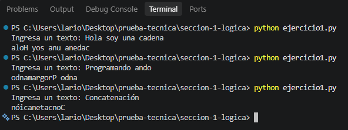
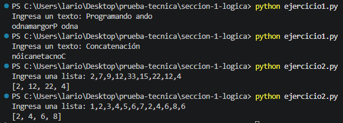
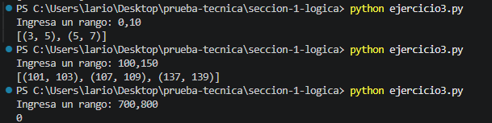
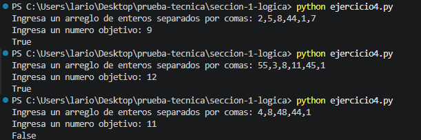
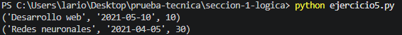

# SECCIÓN 1: EJERCICIOS LÓGICO - MATEMÁTICO

## Tecnologías utilizadas

**Python:** elegí Python para resolver los ejercicios porque es uno de los lenguajes que mejor manejo, su sintaxis es sencilla y legible y con esto me enfoque en la lógica de cada problema y que el código sea fácil de revisar.

**SQLite:** para el ejercicio 5 utilicé SQLite porque solo se necesitaba ejecutar una consulta rápida sobre unas pocas tablas. No hacía falta una base de datos robusta con servidor (como MySQL o PostgreSQL) y aparte SQLite viene incluido en Python, no requiere instalación ni configuración, y toda la base queda en un solo archivo (`biblioteca.db`), así que cualquiera puede ejecutar el ejercicio sin preparar otra cosa extra.

---

Solucion a los cinco ejercicios
Cada sección explica un poco de qué trata el ejercicio, en qué archivo está la solución y muestra la captura de la prueba.

## Contenido

| # | Ejercicio | Archivo |
|---|-----------|---------|
| 1 | [Invertir palabras](#ejercicio-1-invertir-palabras) | `ejercicio1.py` |
| 2 | [Pares únicos](#ejercicio-2-pares-únicos) | `ejercicio2.py` |
| 3 | [Primos gemelos](#ejercicio-3-primos-gemelos) | `ejercicio3.py` |
| 4 | [Suma objetivo](#ejercicio-4-suma-objetivo) | `ejercicio4.py` |
| 5 | [Préstamos vencidos (SQL)](#ejercicio-5-préstamos-vencidos-sql) | `ejercicio5.sql`, `ejercicio5.py` |

---

## Ejercicio 1: Invertir palabras

**De qué trata:** recibe una cadena de texto, la divide por espacios y devuelve cada palabra invertida, respetando el orden original de las palabras.

**Archivo:** `ejercicio1.py`

| Entrada | Salida |
|---------|--------|
| `"Hola soy una cadena"` | `"aloH yos anu anedac"` |
| `"Programando ando"` | `"odnamargorP odna"` |
| `"Concatenación"` | `"nóicanetacnoC"` |

**Prueba:**



---

## Ejercicio 2: Pares únicos

**De qué trata:** recibe un arreglo de números y retorna un nuevo arreglo que contiene únicamente los números pares, sin repetidos.

**Archivo:** `ejercicio2.py`

| Entrada | Salida |
|---------|--------|
| `[2,7,9,12,33,15,22,12,4]` | `[2,12,22,4]` |
| `[1,2,3,4,5,6,7,2,4,6,8,6]` | `[2,4,6,8]` |

**Prueba:**



---

## Ejercicio 3: Primos gemelos

**De qué trata:** recibe dos enteros, `inicio` y `fin`, y devuelve la lista de pares de números primos gemelos (primos cuya diferencia es 2) que están dentro del rango.

**Archivo:** `ejercicio3.py`

| Entrada | Salida |
|---------|--------|
| `0, 10` | `(3,5), (5,7)` |
| `100, 150` | `(101,103), (107,109), (137,139)` |
| `700, 800` | `0` |

> **Notas:** 149 y 151 son primos gemelos, pero 151 queda fuera del rango `100, 150`. En el rango `700, 800` no hay primos gemelos, por eso la salida es `0`.

**Prueba:**



---

## Ejercicio 4: Suma objetivo

**De qué trata:** recibe un arreglo de enteros y un número objetivo, y determina si existe alguna combinación de elementos (sin repetir valores) cuya suma sea igual al objetivo.

**Archivo:** `ejercicio4.py`

| Entrada | Salida | Por qué |
|---------|--------|---------|
| `[2,5,8,44,1,7], 9` | `TRUE` | 8+1=9 o 2+7=9 |
| `[55,3,8,11,45,1], 12` | `TRUE` | 3+8+1=12 |
| `[4,8,48,44,1], 11` | `FALSE` | Ninguna combinación suma 11 |

**Prueba:**



---

## Ejercicio 5: Préstamos vencidos (SQL)

**De qué trata:** consulta SQL que identifica los libros que la alumna Sonia tiene prestados, que no ha devuelto y cuyo préstamo está vencido al día 30/07/2021.

**Archivos:**

- `ejercicio5.sql`: la consulta.
- `biblioteca.sql`: crea las tablas con los datos del enunciado (fechas en formato `AAAA-MM-DD`).
- `biblioteca.db`: base SQLite ya creada a partir de `biblioteca.sql`.
- `ejercicio5.py`: ejecuta la consulta sobre `biblioteca.db` e imprime el resultado:

```bash
python ejercicio5.py
```

**Tablas utilizadas:**

`ALUMNO`

| id | Nombres | Apellidos | Carrera |
|----|---------|-----------|---------|
| 1 | Rosa | Torres | Sistemas |
| 2 | Angel | Perez | Electronica |
| 3 | Sonia | Ríos | Industrial |

`LIBRO`

| Id | Nombre | Editorial | Dias_limite_prestamo |
|----|--------|-----------|----------------------|
| 1 | Administración | Norma | 30 |
| 2 | Redes neuronales | Santillana | 30 |
| 3 | Estadistica | Regio | 10 |
| 4 | Desarrollo web | Limusa | 10 |

`PRESTAMO`

| Id | Id_alumno | Id_libro | Fecha_prestamo | Entregado |
|----|-----------|----------|----------------|-----------|
| 1 | 1 | 1 | 23/7/2021 | false |
| 2 | 1 | 2 | 22/7/2021 | false |
| 3 | 1 | 3 | 15/6/2021 | false |
| 4 | 2 | 1 | 12/7/2021 | false |
| 5 | 3 | 1 | 28/7/2021 | true |
| 6 | 3 | 2 | 16/7/2021 | true |
| 7 | 3 | 3 | 28/7/2021 | true |
| 8 | 3 | 4 | 10/5/2021 | false |
| 9 | 2 | 2 | 28/7/2021 | false |
| 10 | 3 | 2 | 5/4/2021 | false |

**Resultado esperado:**

| Libro | Fecha_prestamo | Dias_limite_prestamo |
|-------|----------------|----------------------|
| Desarrollo web | 10/5/2021 | 10 |
| Redes neuronales | 5/4/2021 | 30 |

**Prueba:**

