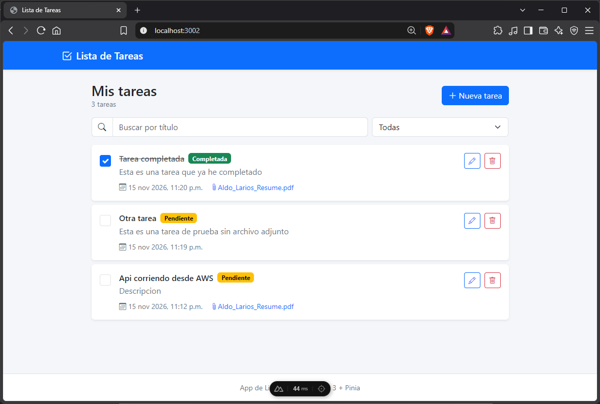
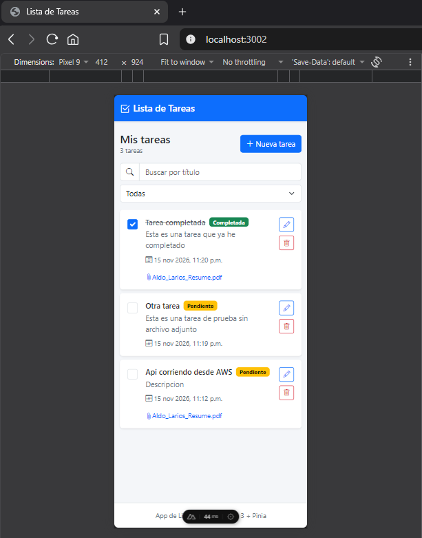

# Ejercicio 2: App de Lista de Tareas

Aplicación web (SPA) para ver, crear, editar, completar y eliminar tareas. Consume la
[API del ejercicio 1](../api/README.md), que está desplegada en AWS.

## Capturas

**Escritorio**



**Móvil**



## Requisitos cubiertos

| Requisito del enunciado | Cómo se resolvió |
|---|---|
| SPA o SSR que consuma la API del ejercicio 1 | SPA con Nuxt 3, conectada a la API desplegada en AWS EC2 |
| Ver, crear, actualizar y eliminar tareas | Lista en [`pages/index.vue`](pages/index.vue) y formulario en [`components/TaskForm.vue`](components/TaskForm.vue) |
| Estado global con Pinia | [`stores/tasks.ts`](stores/tasks.ts): tareas, paginación, filtros y acciones |
| Estilos con Bootstrap | Bootstrap 5 y Bootstrap Icons |
| Validaciones básicas con vuelidate | Título obligatorio (3 a 120 caracteres) y descripción (máx. 1000) |
| Alertas amigables con sweetalert2 | [`composables/useAlerts.ts`](composables/useAlerts.ts): avisos, errores y confirmación antes de eliminar |
| **Extra:** paginación | [`components/AppPagination.vue`](components/AppPagination.vue) |
| **Extra:** composables y layout reutilizable | [`composables/`](composables/) y [`layouts/default.vue`](layouts/default.vue) |
| **Extra:** responsive | Funciona en escritorio y móvil con la cuadrícula de Bootstrap |

Además agregué **búsqueda por título, filtro por estado y archivo adjunto** en cada tarea.

## Tecnologías y por qué

- **Nuxt 3 + Vue 3:** es lo que sugiere el enunciado. La configuré como SPA porque la app no
  necesita SEO y así se puede publicar como archivos estáticos.
- **Pinia:** concentra el estado de las tareas en un solo lugar, así los componentes solo muestran
  datos y llaman acciones.
- **Bootstrap 5:** da un diseño limpio y responsive sin escribir mucho CSS.
- **Vuelidate y sweetalert2:** validan el formulario antes de enviarlo y muestran mensajes claros
  al usuario.

## Cómo correrla

Requiere Node 20+.

```bash
cp .env.example .env     # pega el token que comparto por correo en NUXT_PUBLIC_API_TOKEN
npm install
npm run dev
```

Abre `http://localhost:3002`. La app ya apunta a la API en AWS, así que no hace falta levantar
nada más.

## Estructura

```
app.vue                    # raíz: layout + página
layouts/default.vue        # barra superior, contenedor y pie
pages/index.vue            # pantalla principal: lista, filtros y paginación
components/
├── TaskCard.vue           # una tarea de la lista
├── TaskForm.vue           # modal para crear/editar (vuelidate)
└── AppPagination.vue      # paginador reutilizable
composables/
├── useApi.ts              # cliente HTTP con la URL de la API y el token
└── useAlerts.ts           # alertas con sweetalert2
stores/tasks.ts            # store de Pinia
types/task.ts              # tipos TypeScript
```
